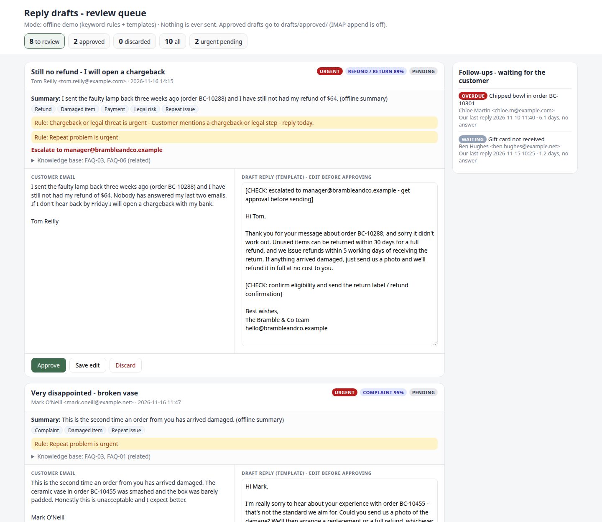
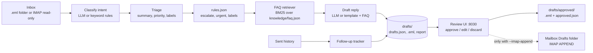

# AI Email Reply Assistant

  

**Reads incoming customer emails, sorts them by urgency, applies your business rules, and writes reply drafts grounded in your own FAQ. A person reviews, edits and approves each draft in the browser. Nothing is ever sent automatically.**



*The review UI (`python -m assistant.review`) after an offline run on the fictional sample inbox. Urgent emails come first; the chargeback email fired two rules and is escalated to a manager; the right panel lists threads where the customer has not answered our last reply.*

## What it does



## Features

| Feature | This project | Typical "AI reply" script |
|---|---|---|
| Human approval | Web review queue: approve, edit, discard, back to review; decisions saved in `review_state.json` | Sends automatically or dumps text to a file |
| Triage | One-line summary, priority (urgent / normal / low), suggested labels per email | Intent only |
| Business rules | `rules.json`: e.g. refund over $100 -> escalate to manager; chargeback / legal words -> urgent; trade-customer domain -> label. Shown on each card | Hard-coded in the prompt |
| Grounded answers | BM25 search over a company FAQ (`knowledge/faq.json`); entries passed to the LLM and cited as `FAQ-04` in the UI | LLM answers from general knowledge |
| Follow-up tracker | Threads where we replied last and the customer has not answered in more than N days (default 3) | - |
| Mailbox integration | Reads IMAP **read-only**; puts approved drafts in the **Drafts** folder with IMAP `APPEND`, only behind `--imap-append` | Needs full send access |
| Works without AI | Offline mode: keyword rules, extractive summary, templates + FAQ. Any AI error falls back per email | Fails without a key |
| Deploy | One command, Dockerfile + docker-compose, GitHub Actions CI | - |

There is **no SMTP code in this project**. The approved draft lands in your mail client's Drafts folder (or as an `.eml` file); a person presses Send.

## Quick start (offline demo, no keys)

Requirements: Python 3.10+ and `requests` (used only in AI mode).

```bash
python -m assistant.main      # read sample_inbox/, write drafts/ (nothing is sent)
python -m assistant.review    # open http://127.0.0.1:8030
```

Or with Docker (files provided, not built in this repo's test run):

```bash
docker compose up --build     # http://127.0.0.1:8030
```

Run the tests (offline, no network):

```bash
python -m unittest discover tests
```

### AI mode

```bash
cp .env.example .env          # add GEMINI_API_KEY (gemini-2.5-flash) or OPENAI_API_KEY
python -m assistant.main
```

The LLM classifies, writes the summary/priority/labels as JSON and adapts the template using only the company facts and the retrieved FAQ entries. Invalid JSON, timeouts, quota or a wrong key fall back to the offline method for that email, and the UI shows which method was used.

### Real mailbox

```bash
# set IMAP_HOST, IMAP_USER, IMAP_PASSWORD in .env (an app password where the provider supports it)
python -m assistant.main --source imap          # read unread mail, read-only, nothing marked as read
python -m assistant.review --imap-append        # approving a draft also APPENDs it to Drafts
python -m assistant.imap_drafts                 # dry run: list approved drafts not yet in Drafts
python -m assistant.imap_drafts --imap-append   # append them (never sends)
```

## Sample result (offline mode, fictional inbox)

| Email | Intent (confidence) | Priority | Rules fired |
|---|---|---|---|
| Still no refund - I will open a chargeback | Refund 0.89 | urgent | Chargeback or legal threat is urgent; Repeat problem is urgent |
| Very disappointed - broken vase | Complaint 0.95 | urgent | Repeat problem is urgent |
| Refund for order BC-10602 - dining chairs ($240) | Refund 0.78 | normal | Refund over $100 needs a manager -> escalated |
| Wholesale enquiry for our cafe | Other 0.50 | normal | Trade customers get a label; draft answered from FAQ-04 |
| Booking the pottery workshop ("no rush") | Booking 0.95 | low | - |
| 5 more (order status, refunds, damaged item) | | normal | - |

Follow-ups from `sample_history/`: "Chipped bowl" overdue (6.1 days without an answer), "Gift card not received" waiting (1.2 days), "Mug colours" not listed because the customer replied last.

These are the rule-based outputs on 10 made-up emails, not a measured accuracy figure.

## Configuration

| Variable / file | Purpose |
|---|---|
| `GEMINI_API_KEY`, `GEMINI_MODEL` | Gemini key and model (default `gemini-2.5-flash`). Read from the environment only, never logged |
| `OPENAI_API_KEY`, `OPENAI_MODEL` | Used if no Gemini key is set (default `gpt-4o-mini`) |
| `IMAP_HOST`, `IMAP_USER`, `IMAP_PASSWORD`, `IMAP_PORT` | Mailbox for `--source imap` and `--imap-append` |
| `IMAP_MAILBOX`, `IMAP_LIMIT` | Folder and number of unread emails to read |
| `IMAP_DRAFTS_FOLDER` | Where approved drafts go (`Drafts`; Gmail: `[Gmail]/Drafts`) |
| `rules.json` | Business rules. Conditions: `intent_in`, `keywords_any`, `amount_over`, `sender_domain_in`, `priority_in`. Actions: `priority`, `add_labels`, `escalate_to`, `note`. Unknown keys are rejected |
| `knowledge/faq.json` | The FAQ the drafts are grounded in |
| `templates/` | `company.json` (facts, signature) and one reply template per intent |
| `--followup-days N` | Days without a customer answer before a thread is "overdue" |

With the sample folder, "now" for the follow-up tracker is the newest sample message, so the demo gives the same result on any day. With IMAP it is the real time.

## Review API (used by the UI)

```
GET  /api/drafts                 drafts + triage + rules + FAQ + review status
GET  /api/followups              threads waiting for the customer
GET  /api/approved               approved drafts as JSON
POST /api/drafts/<id>/approve    {"draft": "optional edited text"}
POST /api/drafts/<id>/save       {"draft": "..."}
POST /api/drafts/<id>/discard
POST /api/drafts/<id>/reopen
```

The server listens on 127.0.0.1 by default and has no login: put it behind a VPN or a reverse proxy with authentication before exposing it.

## What needs real accounts (not tested in this repo)

- **AI mode** needs your own Gemini or OpenAI key. The AI code paths are covered by tests with a mocked LLM, including the fallbacks; real model output was not part of the test run.
- **IMAP read and APPEND** need a real mailbox. APPEND is tested against a fake IMAP class (folder, `\Draft` flag, login/logout, failure kept visible in the UI). Providers differ in Drafts folder names and app-password rules.
- **Docker** files are provided but were not built in this environment.

## Adapting it for a client

- Replace `templates/company.json`, the templates and `knowledge/faq.json` with the client's policies and help-centre articles.
- Add rules in `rules.json` (VIP domains, thresholds, words that need a manager).
- Connect live data: order status from Shopify/WooCommerce by the extracted order number to fill `[CHECK]` notes.
- Run `assistant.main` every 10 minutes with cron/systemd or from n8n; keep the review step.

## Sample data

`sample_inbox/` (10 emails) and `sample_history/` (3 older threads) are generated by `scripts/make_sample_inbox.py`. **Bramble & Co and all people, addresses, order numbers and FAQ answers are fictional.**

## File tree

```
ai-email-reply/
├── assistant/
│   ├── main.py          # CLI: read -> classify -> triage -> rules -> FAQ -> draft -> save
│   ├── review.py        # review UI + JSON API (stdlib http.server, port 8030)
│   ├── web/review.html  # the review page (vanilla JS, no build step)
│   ├── store.py         # approve / edit / discard state + approved/ export
│   ├── triage.py        # summary, priority, labels (LLM or rules)
│   ├── rules.py         # rules.json engine (amounts, keywords, domains)
│   ├── knowledge.py     # FAQ knowledge base + BM25 retriever
│   ├── followups.py     # threads waiting for a customer reply
│   ├── imap_drafts.py   # IMAP APPEND to Drafts behind --imap-append (never sends)
│   ├── classifier.py    # intent: LLM or keyword rules
│   ├── drafter.py       # template / LLM drafts grounded in facts + FAQ
│   ├── inbox.py         # .eml folder reader + read-only IMAP reader
│   ├── eml.py           # draft .eml builder
│   ├── report.py        # static HTML report
│   └── llm.py           # Gemini / OpenAI REST client (requests)
├── knowledge/faq.json   # fictional FAQ
├── rules.json           # business rules
├── templates/           # company facts + reply templates
├── sample_inbox/  sample_history/
├── drafts/              # output of the offline demo run
├── tests/               # 37 offline tests
├── Dockerfile  docker-compose.yml  .github/workflows/tests.yml
└── docs/screenshot.png  docs/screenshot-mobile.png
```
